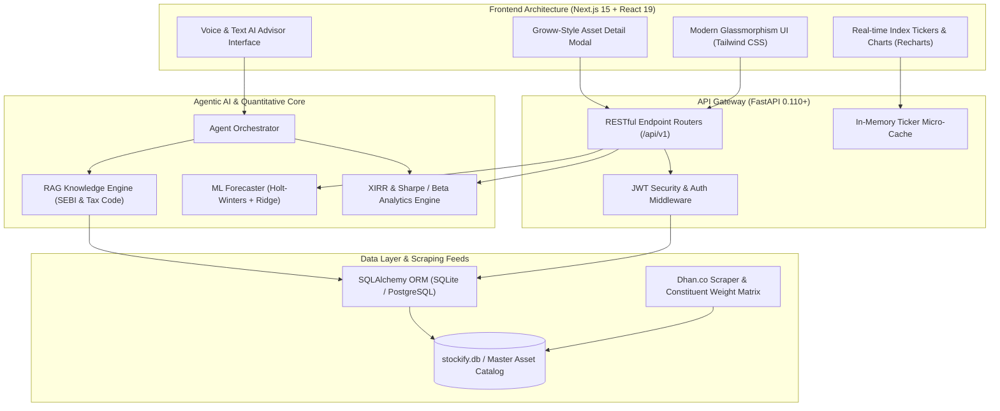

<div align="center">

# 💎 WealthCraft AI
### Institutional-Grade Wealth Intelligence & Autonomous Portfolio Architecture

[](https://nextjs.org/)
[](https://react.dev/)
[](https://fastapi.tiangolo.com/)
[](https://www.python.org/)
[](https://tailwindcss.com/)
[](https://www.sqlalchemy.org/)
[](https://opensource.org/licenses/MIT)

<br/>

[](https://vercel.com/new/clone?repository-url=https%3A%2F%2Fgithub.com%2FSakshamSuper%2FWealthCraft-AI&root-directory=frontend)
&nbsp;&nbsp;
[](https://render.com/deploy?repo=https://github.com/SakshamSuper/WealthCraft-AI)


<p align="center">
  <b>WealthCraft AI</b> is an enterprise-grade wealth advisory, multi-asset screening, and quantitative portfolio optimization suite. Engineered with an ultra-modern aesthetic inspired by <b>Groww, Zerodha, and Morningstar</b>, WealthCraft unites real-time Indian stock exchange feeds (NSE/BSE), constituent index impact matrices from <b>Dhan.co</b>, machine learning valuation forecasts, and an agentic RAG financial orchestrator.
</p>

[Key Features](#-core-capabilities) • [Live Showcase](#-application-showcase) • [System Architecture](#-system-architecture) • [Dhan Live Impact Matrix](#-dhan-nifty-50-constituent-matrix) • [Installation & Setup](#-installation--quick-start) • [API Reference](#-api-specification)

---

</div>

## 📸 Application Showcase

### 1. 📊 Executive Wealth & Markets Dashboard
> Real-time global and domestic exchange tickers (NIFTY 50, SENSEX, BANK NIFTY, MIDCPNIFTY, FINNIFTY, S&P 500), continuous portfolio net-worth tracker, capital allocation pie charts, benchmark outperformance curves, and live volume shockers.

<div align="center">
  
</div>

---

### 2. 🔍 Unified Multi-Asset Screener (204+ Master Instruments)
> High-performance screener covering **108 Listed Equities (NIFTY 50 / 100)**, **30 Index & Commodity ETFs**, and **66 Mutual Funds**. Filter instantly by asset class, sector, P/E multiples, 52-week price channels, expense ratios, AUM, and Morningstar/CRISIL star ratings.

<div align="center">
  
</div>

---

### 3. 🎯 Groww-Style Asset Analysis & Price Trajectory Modal
> Deep fundamental card modeled directly after modern institutional trading terminals:
> - **Analyst Consensus Dial**: Circular Buy / Hold / Sell distribution with 64% buy consensus rating.
> - **52-Week Range & Intraday Channels**: Live position pins displaying today's low/high and 52-week bounds.
> - **Predictive Analyst Price Target**: Machine-learning generated High, Target, and Low forward trajectory envelopes.
> - **5-Year Valuation Slider**: Dynamic valuation peg comparing current P/E against 5-year lowest, industry median, and historical highs.
> - **Sector Peer Benchmark Matrix**: Live comparison against industry peers (P/E, Market Cap, 1-Year Returns).

<div align="center">
  
</div>

---

### 4. 💼 Precision Portfolio Manager & XIRR Engine
> Multi-holding tracking across individual stock lots, ETFs, and SIP mutual funds. Computes exact **Newton-Raphson XIRR (Extended Internal Rate of Return)**, absolute gains, CAGR, asset allocation drift, and automated rebalancing alerts.

<div align="center">
  
</div>

---

### 5. ⚖️ Institutional Multi-Fund Comparison Matrix
> Side-by-side comparative analysis of up to 5 funds or stocks simultaneously. Automatically evaluates **Sharpe Ratio**, **Sortino Ratio**, **Treynor Ratio**, **Alpha**, **Beta**, **Expense Ratio**, and **Upside/Downside Capture** to algorithmically crown the statistical winner.

<div align="center">
  
</div>

---

### 6. 🤖 Autonomous Multi-Agent AI Wealth Advisor
> Conversational financial intelligence engine augmented by **Retrieval-Augmented Generation (RAG)**. Grounded in official SEBI investment mandates, Indian capital gains taxation provisions (LTCG / STCG rules), and client risk scores. Equipped with speech synthesis (TTS) and live voice recognition.

<div align="center">
  
</div>

---

## ⚡ Core Capabilities

- **⚡ Live Exchange Feed & Dhan.co Index Engine**:
  - Live micro-cached tick updates for **NIFTY 50**, **SENSEX**, **BANK NIFTY**, **MIDCPNIFTY**, **FINNIFTY**, and **S&P 500**.
  - Direct integration with Dhan's **Nifty 50 Constituent Matrix** calculating real-time point-by-point index weightage contribution.
- **📈 Comprehensive Master Asset Database (204+ Assets)**:
  - **108 Top Listed Equities**: Reliance, TCS, HDFC Bank, Bharti Airtel, Infosys, ICICI Bank, State Bank of India, ITC, L&T, Tata Motors, and more with full fundamental ratios ($P/E$, $P/B$, Dividend Yield, 52W High/Low).
  - **30 High-Liquidity ETFs**: NIFTYBEES, BANKBEES, GOLDBEES, JUNIORBEES, ITBEES, CPSEETF, SILVERBEES.
  - **66 Top Rated Mutual Funds**: Bluechip, Flexi Cap, Mid Cap, Small Cap, Hybrid, and ELSS Tax Savers.
- **🧠 Machine Learning NAV & Price Forecasting**:
  - Blended ensemble of **Holt-Winters Exponential Smoothing** and **Regularized Ridge Regression** generating multi-quarter trajectory forecasts with 95% confidence intervals.
- **🧮 Quantitative Portfolio Metrics**:
  - Accurate **XIRR** using cash-flow date discounting via the Newton-Raphson root-finding algorithm.
  - Risk-adjusted return assessment: **Sharpe Ratio**, **Sortino Ratio** (downside deviation penalization), **Alpha**, **Beta** vs. NIFTY 50 TRI, and **Maximum Drawdown**.
- **🛡️ Enterprise Security & Multi-Tenant Architecture**:
  - Cryptographic **JWT authentication** with bcrypt salt hashing.
  - Demo sandbox credentials for instant zero-configuration walkthroughs.

---

## 🏗️ System Architecture



---

## 📊 Dhan Nifty 50 Constituent Matrix

WealthCraft AI ingests live constituent telemetry from [Dhan Nifty Stocks List](https://dhan.co/nifty-stocks-list/). The platform computes how individual equity price movements drive the entire NIFTY 50 index using the official Free-Float Market Capitalization impact formula:

$$\text{Index Point Contribution} = \text{Current Index Level} \times \left( \frac{\text{Constituent Weight \%}}{100} \right) \times \left( \frac{\text{Stock Price Change \%}}{100} \right)$$

### Top 10 Constituent Weights in WealthCraft Matrix:
| Stock Ticker | Company Name | Sector | Weightage (%) | Current P/E | 52W High (₹) |
|---|---|---|---|---|---|
| **HDFCBANK.NS** | HDFC Bank Ltd | Banking & Finance | **13.52%** | 14.52x | 1,794.00 |
| **RELIANCE.NS** | Reliance Industries Ltd | Oil, Gas & Energy | **10.20%** | 20.31x | 1,611.80 |
| **ICICIBANK.NS** | ICICI Bank Ltd | Banking & Finance | **7.90%** | 17.53x | 1,360.00 |
| **INFY.NS** | Infosys Ltd | Information Technology | **5.80%** | 24.12x | 1,991.45 |
| **ITC.NS** | ITC Ltd | FMCG & Consumer | **4.40%** | 22.80x | 520.00 |
| **TCS.NS** | Tata Consultancy Services Ltd | Information Technology | **4.10%** | 26.40x | 4,585.00 |
| **LT.NS** | Larsen & Toubro Ltd | Capital Goods & Infra | **3.90%** | 31.20x | 3,948.00 |
| **AXISBANK.NS** | Axis Bank Ltd | Banking & Finance | **3.30%** | 12.80x | 1,339.65 |
| **KOTAKBANK.NS** | Kotak Mahindra Bank Ltd | Banking & Finance | **3.10%** | 19.40x | 1,908.00 |
| **BHARTIARTL.NS** | Bharti Airtel Ltd | Telecommunications | **2.90%** | 35.81x | 1,779.00 |

---

## 🛠️ Tech Stack & Engineering Specifications

### Frontend
- **Framework**: [Next.js 15.5.20](https://nextjs.org/) (React 19, App Router)
- **Styling**: [Tailwind CSS v3.4](https://tailwindcss.com/) with custom dark glassmorphism design tokens
- **Data Visualization**: [Recharts](https://recharts.org/) (Interactive area curves, multi-line forecast cones, allocation bars)
- **Icons & UI Utilities**: [Lucide React](https://lucide.dev/), `clsx`, `tailwind-merge`
- **Speech APIs**: Native Web Speech Recognition API & Web Speech Synthesis API

### Backend & AI Engine
- **Web Framework**: [FastAPI 0.110+](https://fastapi.tiangolo.com/) with asynchronous non-blocking request pipelines
- **Data Modeling & ORM**: [SQLAlchemy 2.0](https://www.sqlalchemy.org/) with SQLite (local) and PostgreSQL support
- **Machine Learning**: `scikit-learn` (Ridge Regression), `statsmodels` (Holt-Winters Triple Exponential Smoothing), `numpy`, `pandas`
- **Security**: PyJWT, passlib with bcrypt, OAuth2 Password Bearer flow
- **RAG & Agentic Architecture**: FAISS vector store, TF-IDF lexical ranking, AMFI & SEBI tax guidelines

---

## 🚀 Installation & Quick Start

### Prerequisites
- **Python 3.10+** (Python 3.11+ recommended)
- **Node.js 18+** & **npm 9+**
- **Git**

### 1. Clone the Repository
```bash
git clone https://github.com/SakshamSuper/WealthCraft-AI.git
cd WealthCraft-AI
```

### 2. Backend Setup
```bash
# Create and activate Python virtual environment
python -m venv venv

# Windows:
.\venv\Scripts\activate

# macOS / Linux:
source venv/bin/activate

# Install backend dependencies
pip install -r backend/requirements.txt

# Populate Master Asset Database (204 stocks, ETFs, mutual funds, 5Y NAVs, peers)
python database/populate_all_market_assets.py

# Start FastAPI server on port 8000
uvicorn app.main:app --app-dir backend --port 8000 --reload
```
> 📚 **FastAPI Swagger Docs**: Available at `http://127.0.0.1:8000/docs`

### 3. Frontend Setup
```bash
cd frontend

# Install Node dependencies
npm install

# Start Next.js development server
npm run dev
```
> 🌐 **WealthCraft Web Client**: Accessible at `http://localhost:3000`

### 4. Demo Login Credentials
The database comes pre-seeded with a comprehensive demo portfolio:
- **Email**: `demo@wealthcraft.ai`
- **Password**: `password123`
- *(Alternatively, you can create a new account via the onboarding wizard on the home page).*

---

## 📋 API Specification

| Method | Endpoint | Description |
|---|---|---|
| `POST` | `/api/v1/auth/login` | Authenticate user & issue JWT bearer access token |
| `POST` | `/api/v1/auth/register` | Register new user profile with risk appetite questionnaire |
| `GET` | `/api/v1/funds/` | Query master assets with search, category, risk, and rating filters |
| `GET` | `/api/v1/funds/{id}` | Retrieve comprehensive asset details and fundamental ratios |
| `GET` | `/api/v1/funds/{id}/nav-history` | 5-Year historical daily NAV / close price records |
| `GET` | `/api/v1/funds/{id}/forecast` | Multi-scenario ML forecast with upper, target, and lower bounds |
| `GET` | `/api/v1/funds/{id}/peers` | Sector peer comparison matrix with live valuations |
| `GET` | `/api/v1/funds/compare` | Multi-fund side-by-side risk-adjusted comparison |
| `GET` | `/api/v1/portfolio/` | Portfolio valuation summary, CAGR, XIRR, and asset allocation |
| `POST` | `/api/v1/portfolio/items` | Record a new asset transaction (units, purchase price, date) |
| `POST` | `/api/v1/chat/message` | Send query to autonomous RAG AI Wealth Advisor |
| `GET` | `/api/v1/reports/pdf` | Generate comprehensive portfolio intelligence tear sheet |

---

## 📂 Repository Structure

```
WealthCraft-AI/
├── frontend/                       # Next.js 15 Client Web Application
│   ├── app/                        # App Router Pages
│   │   ├── dashboard/              # Executive FinTech Dashboard
│   │   ├── screener/               # Multi-Asset Screener (Stocks/MFs/ETFs)
│   │   ├── portfolio/              # Portfolio Manager & XIRR Tracker
│   │   ├── compare/                # Side-by-Side Fund Comparison Matrix
│   │   ├── goals/                  # Goal Planning & SIP Calculator
│   │   ├── chat/                   # Autonomous AI Wealth Advisor
│   │   └── page.tsx                # Dynamic Onboarding & Auth Portal
│   ├── components/                 # Reusable UI Components
│   │   ├── AssetDetailModal.tsx    # Groww-Style 5-Tab Fundamental Card
│   │   ├── MarketTicker.tsx        # Real-Time Stock & Global Index Banner
│   │   ├── Navbar.tsx              # Navigation & Instant Search Modal
│   │   └── ...
│   └── lib/                        # API Client & Data Types
├── backend/                        # FastAPI High-Performance Backend
│   ├── app/
│   │   ├── api/endpoints/          # REST Endpoints (auth, funds, portfolio, chat)
│   │   ├── core/                   # Security, DB Sessions, Settings
│   │   ├── crud/                   # Database CRUD Operations
│   │   ├── models/                 # SQLAlchemy Database Schema
│   │   ├── schemas/                # Pydantic v2 Request/Response Schemas
│   │   └── services/               # XIRR Calculators & Math Engines
│   └── main.py                     # ASGI Entrypoint
├── agents/                         # Multi-Agent Financial Orchestrator
│   └── orchestrator.py             # RAG Node, Tax Advisor, Risk Profiler
├── ml/                             # Machine Learning Analytics Core
│   └── engine.py                   # Holt-Winters & Ridge Regression Forecasters
├── database/                       # Database Provisioning & Seeders
│   ├── populate_all_market_assets.py # Master Seeder (204 assets, NAVs, peers)
│   ├── scrape_dhan_nifty50.py      # Dhan.co NIFTY 50 Live Scraper
│   └── dhan_nifty_stocks.json      # Structured Constituent Matrix
└── docs/screenshots/               # High-Resolution UI Documentation Assets
    ├── 01_dashboard.png
    ├── 02_screener.png
    ├── 03_asset_detail_modal.png
    ├── 04_portfolio.png
    ├── 05_compare.png
    └── 06_ai_advisor.png
```

---

## 📜 License
This project is licensed under the **MIT License** — see the [LICENSE](LICENSE) file for details.

---

<div align="center">
  <b>Built with ❤️ for Indian and Global Investors. Empowering data-driven financial freedom.</b>
</div>
