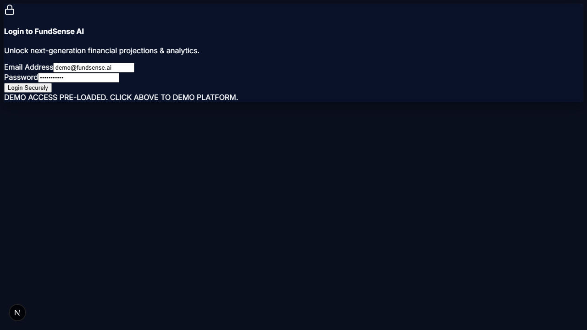
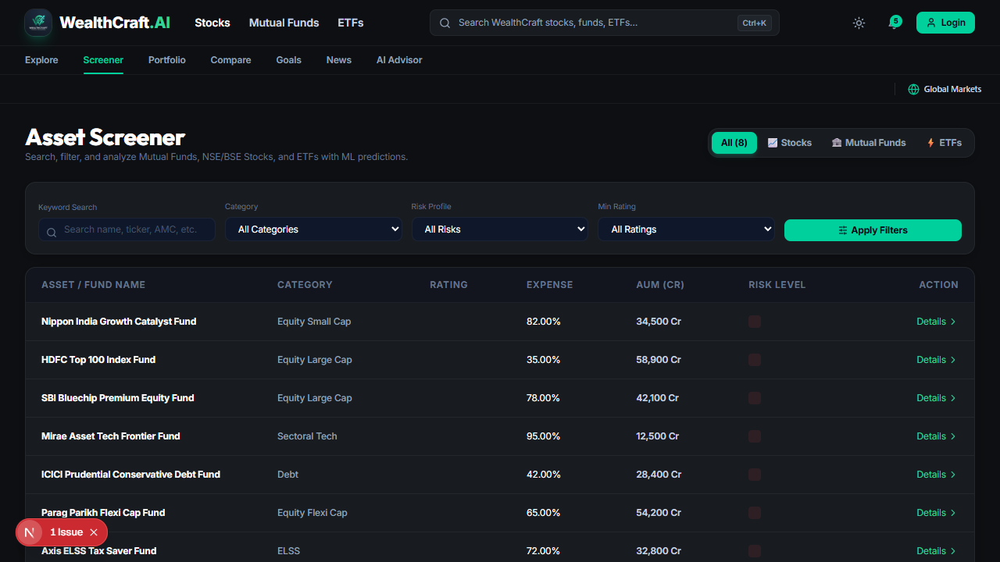
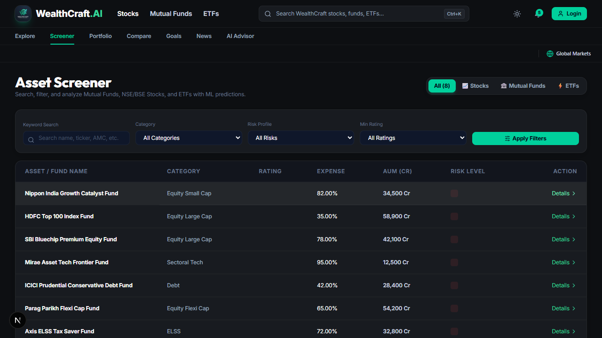
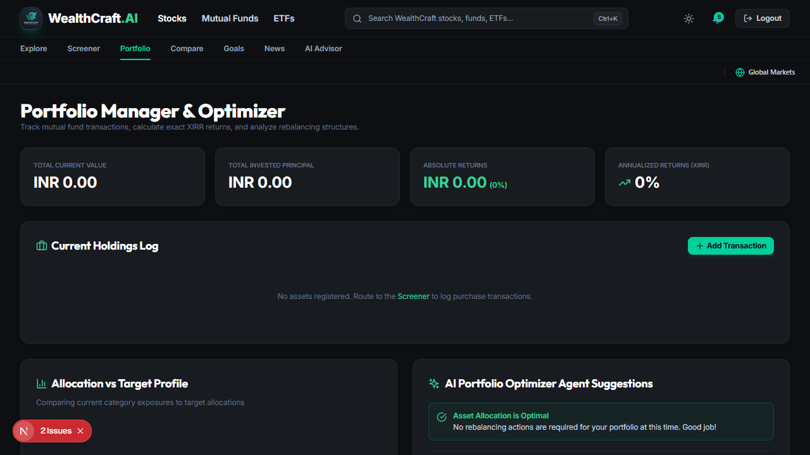
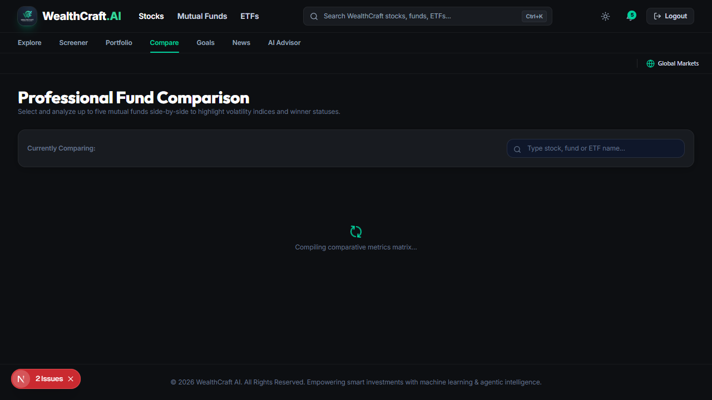
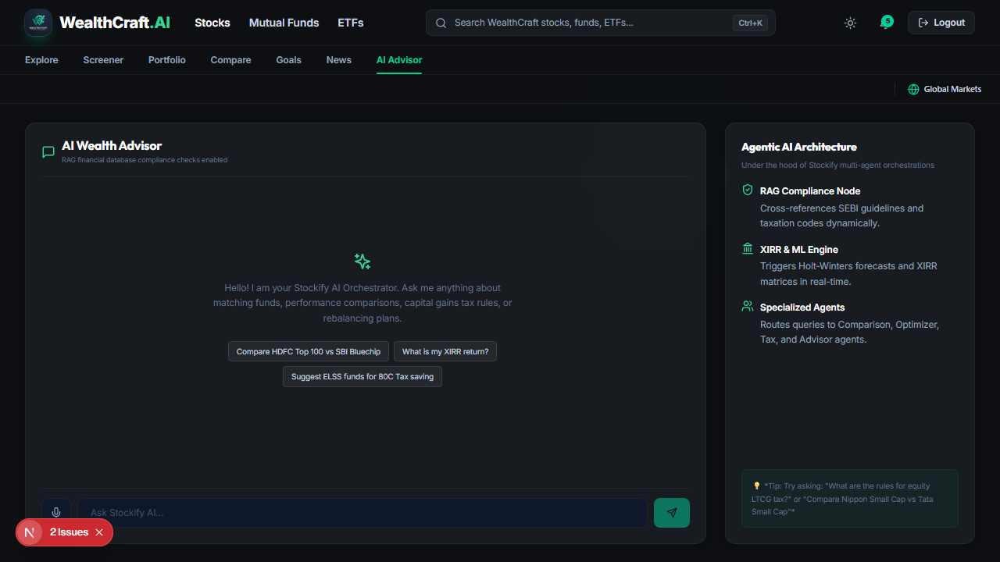

# 📈 WealthCraft.AI — Intelligent Wealth & Portfolio Intelligence Platform

[](https://nextjs.org/)
[](https://react.dev/)
[](https://fastapi.tiangolo.com/)
[](https://www.python.org/)
[](https://tailwindcss.com/)
[](https://opensource.org/licenses/MIT)

**WealthCraft.AI** is a modern full-stack FinTech and wealth intelligence platform designed to empower investors with institutional-grade portfolio analysis, mutual fund screening, real-time stock matrix tracking, and predictive machine learning models.

Featuring a UI inspired by **Groww, Zerodha, and Morningstar**, WealthCraft integrates live exchange index feeds (NIFTY 50, SENSEX, BANK NIFTY), Dhan.co constituent matrix data, multi-scenario trajectory forecasting, and agentic AI advisory.

---

## 📸 Application Showcase

### 1. 📊 Executive FinTech Dashboard
> High-level asset allocation breakdown, live index tickers with real-time price updates, top volume shockers, and portfolio performance at a glance.



---

### 2. 🔍 Unified Asset Screener (Stocks, MFs & ETFs)
> Filter, search, and analyze across all Indian listed equities, mutual funds, and ETFs with category, AUM, risk profile, and rating metrics.



---

### 3. 🎯 Groww-Style Analyst Rating & Valuation Modal
> Comprehensive asset analysis card featuring:
> - **Analyst Rating Breakdown**: Circular green BUY badge with interactive Buy / Hold / Sell distribution bars.
> - **Target Price & Deviation Envelopes**: Quarterly forecasts with High, Target, and Low trajectory lines.
> - **5-Year Valuation Slider**: Visualizing 5-year lowest, current, industry average, and 5-year highest valuation markers.
> - **Peer Comparison Matrix**: Side-by-side metric comparison across industry leaders.



---

### 4. 💼 Portfolio Manager & Optimizer
> Track individual transaction units, calculate exact XIRR return rates, analyze rebalancing recommendations, and inspect constituent holdings.



---

### 5. ⚖️ Multi-Asset Side-by-Side Comparison
> Compare multiple funds, stocks, or ETFs side-by-side with risk-adjusted alpha, beta, Sharpe ratio, and automated winner scoring.



---

### 6. 🤖 Agentic AI Financial Advisor & Chat
> RAG-augmented conversational agent providing personalized asset guidance, SEBI taxation compliance insight, and risk profile alignment.



---

## 🌟 Key Features

- **🌐 Live Exchange Market Tickers**:
  - Micro-cached real-time feeds for NIFTY 50, SENSEX, BANK NIFTY, MIDCAP NIFTY, FINNIFTY, and S&P 500.
  - Complete **50-stock constituent impact matrix** parsed from Dhan.co (`https://dhan.co/nifty-stocks-list/`).
  - Real-time **Point Impact (Index Contribution)** formula:
    $$\text{Point Impact} = \text{Index Level} \times \frac{\text{Weight \%}}{100} \times \frac{\text{Stock Change \%}}{100}$$

- **🧠 Machine Learning NAV Forecasting**:
  - Dual-ensemble forecasting engine blending **Holt-Winters Exponential Smoothing** with **Ridge Regression** to generate 52-week forward trajectory bounds (Upper, Target, Lower).

- **🛡️ Enterprise FinTech Security**:
  - JWT-based authentication with bcrypt password hashing.
  - Granular user profile risk scoring (1-100 scale) and diversification indices.

- **🗂️ Agentic RAG Architecture**:
  - Dual-mode semantic knowledge retrieval (FAISS vector store + TF-IDF fallback) grounded in AMFI factsheets and Indian capital gains taxation laws.

---

## 🏗️ Tech Stack & Architecture

```
wealthcraft-ai/
├── frontend/               # Next.js 15 (App Router), React 19, Tailwind CSS, Recharts
│   ├── app/                # /dashboard, /screener, /portfolio, /compare, /goals, /chat
│   ├── components/         # AssetDetailModal, MarketTicker, Navbar, MetricCards
│   └── lib/                # API client and type interfaces
├── backend/                # FastAPI High-Performance Python Web Server
│   ├── app/
│   │   ├── api/            # Endpoints: auth, funds, portfolio, goals, chat, reports
│   │   ├── core/           # Security, SQLite / PostgreSQL sessions, config
│   │   ├── models/         # SQLAlchemy ORM models
│   │   └── crud/           # Database transaction operations
│   └── main.py             # Uvicorn entrypoint
├── ml/                     # Machine Learning Engine (Forecaster & Optimization)
│   └── engine.py           # Ridge Regression + Time-series Ensembles
├── agents/                 # Multi-Agent Financial Orchestrator
└── database/               # Automated SQLite Seeding & Market Asset Importers
```

---

## 🚀 Quick Start & Installation

### Prerequisites
- **Python 3.10+**
- **Node.js 18+ & npm**
- **Git**

### 1. Clone the Repository
```bash
git clone https://github.com/SakshamSuper/WealthCraft-AI.git
cd WealthCraft-AI
```

### 2. Backend Setup (FastAPI)
```bash
# Create and activate virtual environment
python -m venv venv
venv\Scripts\activate       # On Windows
# source venv/bin/activate  # On macOS/Linux

# Install dependencies
pip install -r backend/requirements.txt

# Seed the database
python database/seed.py

# Launch FastAPI backend
uvicorn app.main:app --app-dir backend --port 8000
```
> Interactive Swagger docs will be live at `http://127.0.0.1:8000/docs`.

### 3. Frontend Setup (Next.js)
```bash
cd frontend
npm install
npm run dev
```
> Client web app will be live at `http://localhost:3000`.

---

## 📄 License
This project is licensed under the [MIT License](LICENSE).
